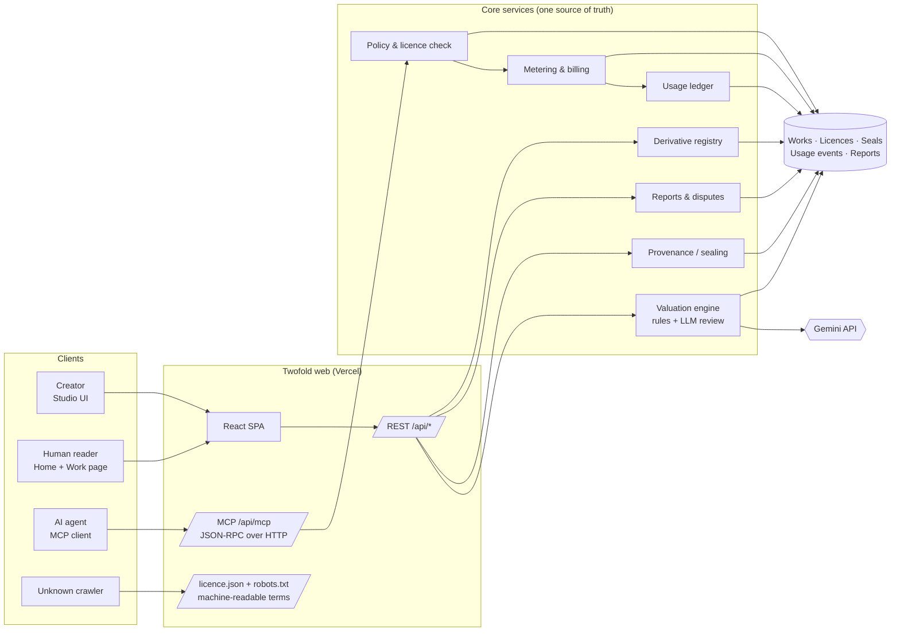
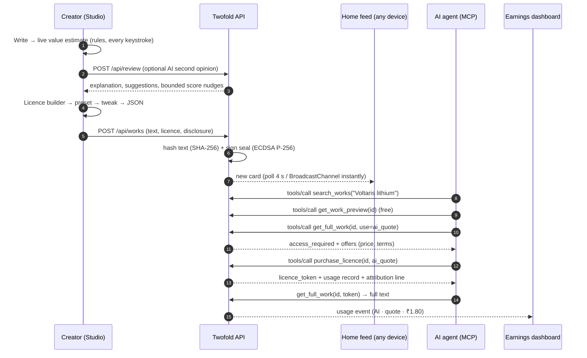

# Twofold — System Design

> **Twofold** (working name): a studio for creators whose audience is half people, half machines.
> One piece of work, two audiences, fair pay from both.

Version 1.1, 24 Nov 2026. Prototype for the Zzazz "AI Creator Studio" assignment

---

## 1. What we are building (scope)

| # | Screen | Who it is for | Required by brief |
|---|--------|---------------|-------------------|
| 0 | **Home** — a simple reader front page with live cards | Human buyer | Added (shows the publish → live loop) |
| 1 | **Write & value** — editor + live AI value panel | Creator | Yes |
| 2 | **Licence builder** — 4 uses, presets, plain English + JSON | Creator | Yes |
| 3 | **Public work page** — preview, price, terms, provenance, *View as AI* toggle | Buyer / AI system | Yes |
| 4 | **Usage & earnings** — people vs AI, by use, over time, derivatives, reports | Creator | Yes |

**Lead creator persona:** Riya Deshpande, an independent markets reporter in Pune (fictional). This matches our core scenario: a trader asks an AI assistant for "the latest on company X"; the assistant reads independent reporting, and today the reporter earns nothing.
Sample texts also cover a researcher's dataset, a hobbyist phone review and a deliberately padded SEO piece, so the estimate can be seen reacting honestly.

**Out of scope for the prototype (Phase 2, described in the deck):** personalised feed with onboarding questionnaire and click-learning recommendations, subscription checkout, real payments, B2B newsroom licensing, verification marketplace.

All companies, creators, buyers and AI systems in the prototype are made up.

---

## 2. Architecture



Key decisions:

1. **One source of truth, two doors.** The web app and the MCP server read the same store. MCP is a thin protocol layer; it owns no data. (We dropped the earlier idea of a separate agent database replicated from a master: it adds sync bugs and no product value. Agents get a *search index* over the same data, not a copy.)
2. **Three layers of AI access control,** because MCP only governs agents that come through the front door:
   - **Front door (MCP):** authenticated clients, metered per call, usage record returned.
   - **Side door (plain HTTP):** unknown bots get preview-only HTML, a `<link rel="license">` to `licence.json`, a licence pointer in `robots.txt` (RSL-style), and HTTP 402 with offers for full text.
   - **After delivery:** contract terms, attribution checks and fingerprint monitoring. We say openly that training use cannot be technically prevented once text is delivered.
3. **Deterministic first, LLM second.** Prices must be reproducible and explainable. Rules score the text live; the LLM writes the explanation and can nudge scores within ±10 points. The plain-English licence summary is generated from the JSON by code, never by the LLM, so the two can never disagree.
4. **Fixed split, dynamic price.** Creator keeps 85 %, platform 15 %, always visible. The *price* moves with demand; the *split* never does.

---

## 3. End-to-end flow



---

## 4. Data model

```ts
Creator   { id, name, handle, beat, location, reputation 0..1, pastPieces, followers, publicKey }
Work      { id, creatorId, kind: 'article'|'video'|'dataset', title, dek, body, topics[],
            disclosure: 'human'|'ai_assisted'|'ai_generated', aiUses[],
            valuation: Valuation, licence: Licence, seal: Seal, status, publishedAt }
Licence   { schema, uses: { read, ai_quote, ai_train, republish }, freePreviewWords, exclusiveWindow? }
Use       { permission: 'free'|'paid'|'ask'|'no', price?: {amount, currency:'INR', unit},
            conditions: { attribution, linkBack, maxQuoteWords, derivatives[], royaltyShare } }
Seal      { contentHash 'sha256:…', signature, publicKey, signedAt, version, previousHash? }
Buyer     { id, name, kind: 'human'|'ai', type: 'reader'|'analyst'|'assistant'|'search'|'model_builder'|'publisher' }
UsageEvent{ id, ts, workId, buyerId, buyerKind, use, units, amount, creatorShare, requestId, via: 'web'|'mcp'|'edge' }
Derivative{ id, parentId, type: 'translation'|'summary'|'clip'|'remix', by, declared: bool,
            similarity, earnings, sharePct, paidBack }
Report    { id, workId, reason, evidence, reporterWeight, status, escrowPct, timeline[] }
```

---

## 5. Value estimate (pre-publish)

The estimate answers one question: **"What is this piece likely to earn in its first 30 days, and why?"** It is a range with a confidence level, never a single magic number.

### 5.1 Signals (0–100), computed live from the text

| Signal | What it rewards | Main inputs |
|---|---|---|
| **Originality (O)** | New, specific, first-hand information | specifics per 100 words (numbers, named entities, quotes), first-hand markers ("memo seen by", "we measured", "our dataset"), lexical variety; minus boilerplate phrases and similarity to commodity text |
| **Depth (D)** | Substance and evidence | *effective* words (padding removed, log-scaled), attributions and sources, attached source documents / raw data, structure |
| **Timeliness (T)** | Being early on something that matters now | time markers, kind of work; each kind has a half-life (news 36 h, analysis 7 d, review 30 d, dataset 1 y) |
| **Demand (Dm)** | Topics people and agents are asking about now | simulated demand index per topic (reader searches + agent queries today), market relevance boost for named listed companies; each topic counted **once** |

```
effectiveWords = words × uniqueSentenceRatio × (1 − trigramRepetition)
Quality  Q = 0.55·O + 0.45·D
Market   M = 0.65·Dm + 0.35·T
Value index V = Q^0.6 · M^0.4          (geometric: a hot topic cannot rescue thin content)
```

### 5.2 From index to money (₹, 30 days)

```
p_read   = (3 + 16·(V/100)^1.3 · kindFactor) × verified          (V < 25 → suggest free, to grow audience)
p_quote  = p_read × quoteRatio × freshness                         (article 0.12: one AI answer meets ~10–15 % of a reader's need)
p_train  = max(₹500, k × E[12-month quote revenue] × (1 − 0.7·perishability) × verified)   one-time, per model; k = 2, datasets 5
p_repub  = max(₹150, p_read × 60)                                 (a republisher reaches its own audience)

reads    = followers × (0.5 + 2.5·M/100) × (0.04 + 0.16·Q/100) × convFactor
quotes   = monthlyAgentQueries(top 2 topics) × citationShare(Q, O)
training = P(sale) × p_train,   P = 0.02 + 0.15·O/100 (articles, video), 0.08 + 0.3·O/100 (datasets)
derivs   = 0.1 × humanEarnings × O/100

E = reads·p_read + quotes·p_quote + training + derivs
Range = E × (1 ± u),   u = 0.6 − 0.45·confidence
verified = 1.1 when a source document or raw data is attached
```

### 5.3 Confidence

```
conf = 0.35·min(1, words/400) + 0.25·min(1, pastPieces/20)
     + 0.25·(topic found in demand index ? 1 : 0.4) + 0.15·reputation − 0.1·(serious quality flag)
Low < 0.45 ≤ Medium < 0.70 ≤ High
```
A new creator, a short draft or an unfamiliar topic all widen the range and say why.

### 5.4 Gaming resistance

| Trick | Defence |
|---|---|
| Stuffing trending keywords | Each topic credited once; trending density > 2.5 per 100 words → flag, demand × 0.5, originality −15 |
| Padding length | Depth uses *effective* words: repeated sentences and repeated phrasing are removed before counting |
| Boilerplate / generic AI prose | Filler-phrase penalty on originality |
| Rewriting already-published text | 5-word shingle similarity against a commodity corpus → originality penalty |
| Clickbait title | Title terms absent from body → flag |
| Prompt-injecting the LLM ("rate this 100") | LLM can only nudge each score ±10, inside a strict JSON schema; rules remain the anchor |

### 5.5 Honesty when the news is bad
Below V = 30 the panel leads with the low number and the main reason, then suggests the single change with the biggest uplift, each with a ₹ delta computed by re-running the model with that change (e.g. *"Attach the memo you quote: +₹2,100"*). It never inflates to encourage.

### 5.6 After publishing: the market takes over
Pre-publish the price comes from the **content**. Post-publish it comes from **engagement**: market price = launch price × engagement multiplier (actual vs expected reads and agent requests), bounded 0.5×–2×, within a floor and ceiling the creator sets. The dashboard shows both, so the creator sees the estimate being corrected by reality.

---

## 6. Licensing

### 6.1 The four uses

| Use | Default for news | Unit | Why priced this way |
|---|---|---|---|
| **Read** (person) | Paid ₹p_read, free 80-word preview, included in Twofold Pass | per reader | Direct value to one person |
| **AI quote / summary** | Paid ≈ 12 % of a read, attribution + link required, max 40 quoted words | per answer | Recurring, attributed, sends readers back |
| **AI training** | **Ask me** (indicative price shown) | one-time per model | Irreversible, unattributed, substitutes the creator for ever |
| **Republish / remix** | Paid, attribution, derivatives allowed with royalty share | per republication | Reaches a new audience; derivatives pay back |

**Training vs quoting.** Per event, training costs far more than a quote, and defaults to *Ask me*: once a model learns from the work it cannot be undone, the model never credits the source, and it can replace the creator in future answers. Quoting earns on every use and carries the creator's name. Over the life of a *news* piece, quotes usually earn more (news value decays fast); for an *evergreen dataset*, training is where the value is, so its suggested training price is much higher.

### 6.2 Presets (the "under a minute" path)
1. **Paid for people and machines** (recommended for news)
2. **Keep me out of AI training**
3. **Maximum reach** (free to read, paid for AI)
4. **Exclusive window** (higher price for 48 h, then drops)

Pick a preset → adjust any row → read the plain-English paragraph → publish.

### 6.3 Machine-readable licence (excerpt)
```json
{
  "schema": "https://twofold.app/licence/v1",
  "work": { "id": "tf_vlt_0001", "content_hash": "sha256:…", "origin": "human", "ai_assistance": ["proofreading"] },
  "free_preview": { "words": 80 },
  "uses": {
    "read":      { "permission": "paid", "price": { "amount": 15, "currency": "INR", "unit": "per_reader" } },
    "ai_quote":  { "permission": "paid", "price": { "amount": 1.8, "currency": "INR", "unit": "per_answer" },
                   "conditions": { "attribution": "required", "link_back": "required", "max_quote_words": 40 } },
    "ai_train":  { "permission": "ask", "indicative_price": { "amount": 10880, "currency": "INR", "unit": "per_model" } },
    "republish": { "permission": "paid", "price": { "amount": 900, "currency": "INR", "unit": "per_republication" },
                   "conditions": { "attribution": "required", "derivatives": ["translation", "summary", "clip"], "royalty_share": 0.3 } }
  },
  "access": { "mcp": "https://<host>/api/mcp", "tools": ["get_work_preview", "get_full_work", "purchase_licence"] }
}
```

---

## 7. Provenance ("proof it has not been altered")

- On publish: normalise text (Unicode NFC, collapse whitespace) → **SHA-256 fingerprint** → sign `{work id, fingerprint, creator, time, disclosure}` with the creator's key (**ECDSA P-256**, WebCrypto).
- On the public page the browser re-computes the fingerprint and checks the signature, then shows plain language: *"Sealed by Riya Deshpande on 24 Nov, 10:02. Unchanged since."* Analogy used in the UI: a wax seal; break one comma and the seal breaks.
- **Check a copy:** paste any text that claims to be this piece → same fingerprint = genuine; otherwise we highlight exactly which words differ.
- Corrections create **version 2** with a link to v1's fingerprint (a hash chain), so edits are visible, not hidden.
- Disclosure (human / AI-assisted for X / AI-generated) is part of the signed seal, so it cannot be quietly changed later.

---

## 8. Derivatives

- A derivative is registered when someone buys a *republish/remix* licence and declares its type. Default upstream shares: translation 30 %, clip 20 %, summary 15 %, remix 25 %. Total upstream share across a chain is capped at 40 % so derivatives stay viable.
- Undeclared copies are found by fingerprint similarity (5-word shingles; for translations, overlap of numbers and names). They appear as *Unclaimed copy, 71 % match* with a one-click *Request licence*.
- The dashboard shows each derivative, what it earned, and what it paid back.

---

## 9. Fake / misleading reports — fair to the creator

| Step | Rule |
|---|---|
| Weighting | Each report carries the reporter's weight (verified buyer of this piece 0.6, subscriber 0.3, anonymous 0.1). New-account bursts are down-weighted, so brigading doesn't work. |
| Trigger | Review opens when total weight ≥ 1.0. |
| Escrow | Only **this piece's new earnings** are held, at min(100 %, 25 % × weight). Past payouts and other pieces are untouched. |
| Creator response | 72 hours to reply with evidence; the piece stays live, marked *Under review*. |
| Outcomes | **Dismissed:** escrow released, reporters' weight falls. **Corrected:** correction published as sealed v2, escrow released. **Upheld:** buyers of this piece refunded from escrow, piece delisted, reputation drops; the creator's next 3 pieces show *Verification pending*. |

---

## 10. MCP server (agent-facing door)

Endpoint `POST /api/mcp`, JSON-RPC 2.0, Streamable-HTTP compatible (JSON responses). Methods: `initialize`, `tools/list`, `tools/call`.

| Tool | Cost | Returns |
|---|---|---|
| `search_works(query, filters)` | free | ids, titles, creators, dates, access tier |
| `get_work_metadata(work_id)` | free | creator, date, disclosure, seal, licence JSON |
| `get_work_preview(work_id)` | free | summary, key facts, first 80 words |
| `get_full_work(work_id, use, licence_token?)` | metered | full text + attribution line, **or** `access_required` with offers |
| `purchase_licence(work_id, use)` | priced | licence token + usage record (simulated payment) |
| `report_work(work_id, reason, evidence)` | free | report id + status |

Progressive access (*Discover → Evaluate → Authorise → Retrieve → Measure*): the agent decides whether it needs more; the server decides whether it may have more. Every call becomes a usage event.

---

## 11. Backend, storage and real time

| Piece | Prototype choice | Production direction |
|---|---|---|
| Hosting | Vercel: static Vite build + Node serverless functions in `/api` | Same, plus a dedicated MCP service |
| Store | Upstash Redis if configured; otherwise in-memory per function instance + browser `localStorage` | Postgres (works, licences, ledger) + Redis (quotas, counters) |
| Real time | `BroadcastChannel` across tabs (instant) + polling `/api/works` every 4 s across devices | Server-sent events / websockets |
| LLM | `/api/review` → Gemini (`GEMINI_API_KEY`, model configurable); strict JSON; scores clamped ±10; falls back to rules if the call fails | Model routing + caching per text hash |
| Crypto | WebCrypto SHA-256 + ECDSA P-256 in the browser | Server-side keys in HSM, C2PA manifests |

Env vars: `GEMINI_API_KEY`, `GEMINI_MODEL` (default `gemini-flash-latest`), optional `KV_REST_API_URL`, `KV_REST_API_TOKEN`.

---

## 12. Mock data (one simulated month)

- 1 lead creator + 3 supporting creators; 6 published pieces.
- ~30 days of events per piece: human readers (pay-per-read and Pass reads) and 5 fictional AI systems (an assistant, an AI search engine, a trader's agent, a model builder, a newsletter summariser).
- Weekday/weekend rhythm, a spike on publish day, decay by half-life, one viral day.
- 3 derivatives (Marathi translation, 60-second video clip, newsletter summary) + 1 undeclared copy.
- 2 reports: one dismissed, one under review (with escrow).

Generated with a seeded random generator so numbers are stable between reloads.


## 13. V2: personalisation, semantic search, community

**Onboarding and profile.** First visit to `#/` opens onboarding. The profile (role, name, handle, city, followed keywords, creator defaults) lives in the client store (`localStorage`, key `twofold:v4`); no password in the prototype. An onboarded creator gets the id `g_<handle>`; their published works carry an `author` block so other devices can show their name.

**Relevance engine** (`src/engine/similarity.ts`), used by the feed, related stories and the MCP `search_works` tool:

1. *Index.* Each story becomes a TF-IDF vector over title (×3), keywords (×3), standfirst (×2) and body. Weight = (1 + ln tf) × ln(1 + N/df).
2. *Query expansion.* Query terms keep weight 1; synonyms/concepts (e.g. football → qualifiers, squad, goal) are added at 0.55.
3. *Direct score.* cosine × 1.6 + 0.12 per keyword hit.
4. *Indirect relevance.* A relation graph (`RELATIONS`) links subjects: India ↔ Indonesia (same qualifying group), EVs → lithium (battery costs), farming/loans → monsoon/groundwater, AI → data centres. If the query names a `from` subject and a story is about a `to` subject, it gets +0.32 and the relation's reason. If the story never names the subject asked about, the match is labelled *indirect*.
5. *Output.* `{score 0–1, match: direct|indirect, why, also}`; results below 0.12 are dropped.

**Feed ranking** (`rankForUser`): 1.2 × direct keyword matches + 0.5 if related through the graph + 0.3 × learned taste (likes/saves per keyword) + 0.8 × freshness (linear over 10 days) + 0.4 × log popularity. Promoted stories get a popularity boost.

**New endpoints.** `POST /api/insight` (reading companion: Gemini with structured output, the article treated as untrusted data; retry once on overload; fallback to the writer's notes and an extractive answer). `GET/POST /api/posts` (community; validated, length-capped, stored in the same memory/Redis list pattern as works). `/api/feed` now also returns posts so other devices update within 4 seconds.

**Market panel.** Prices for the fictional companies are simulated client-side (seeded random walk, updated every 2.6 s, paused for reduced-motion users) and labelled as simulated.
